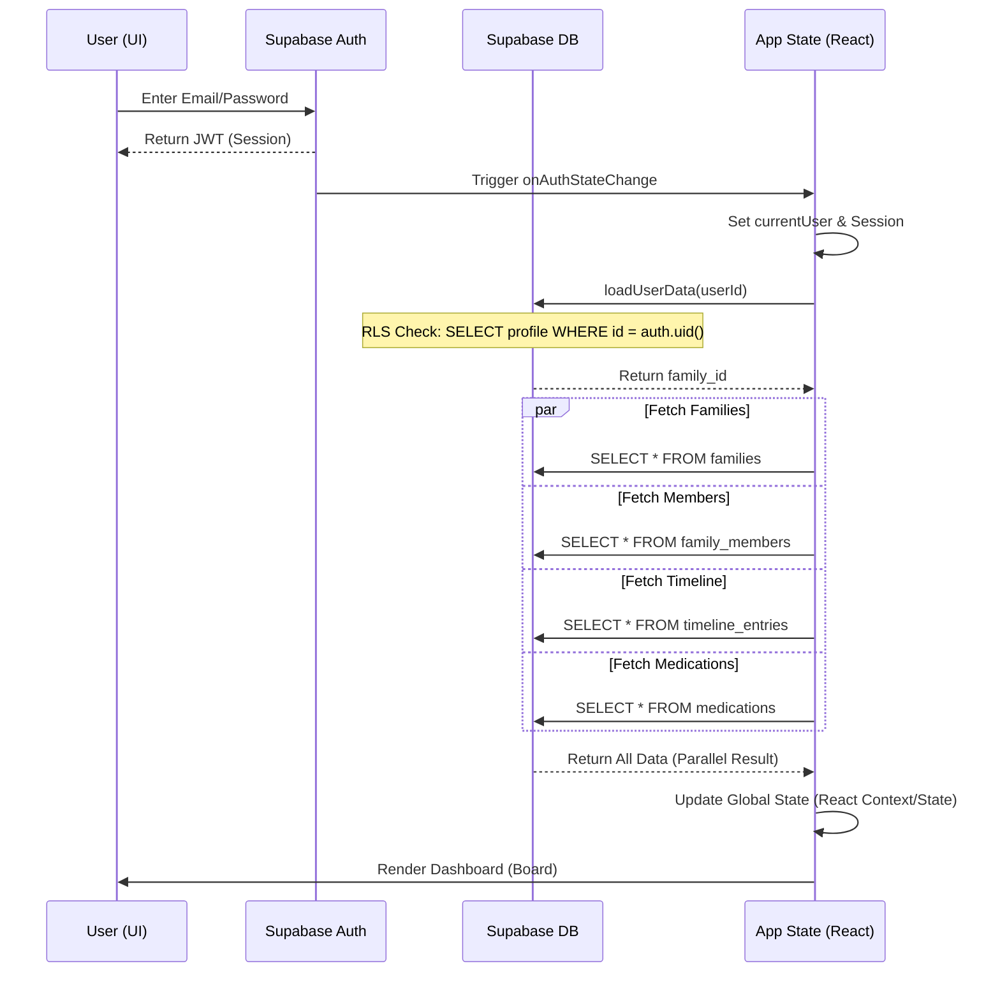
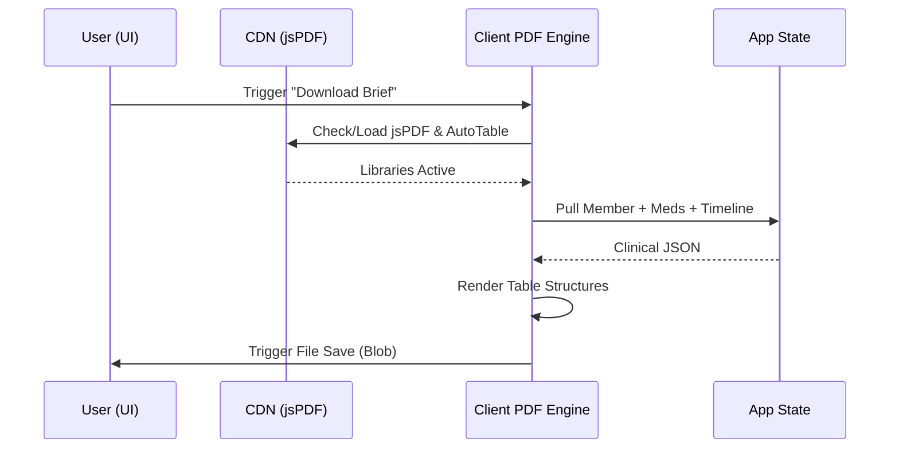
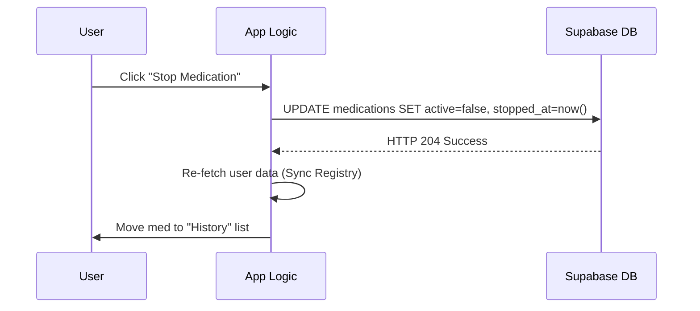
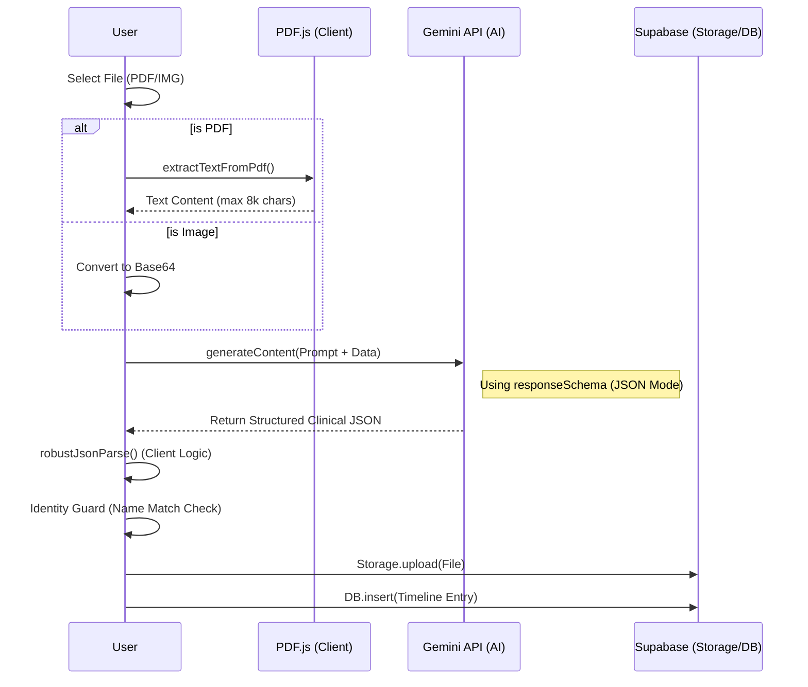
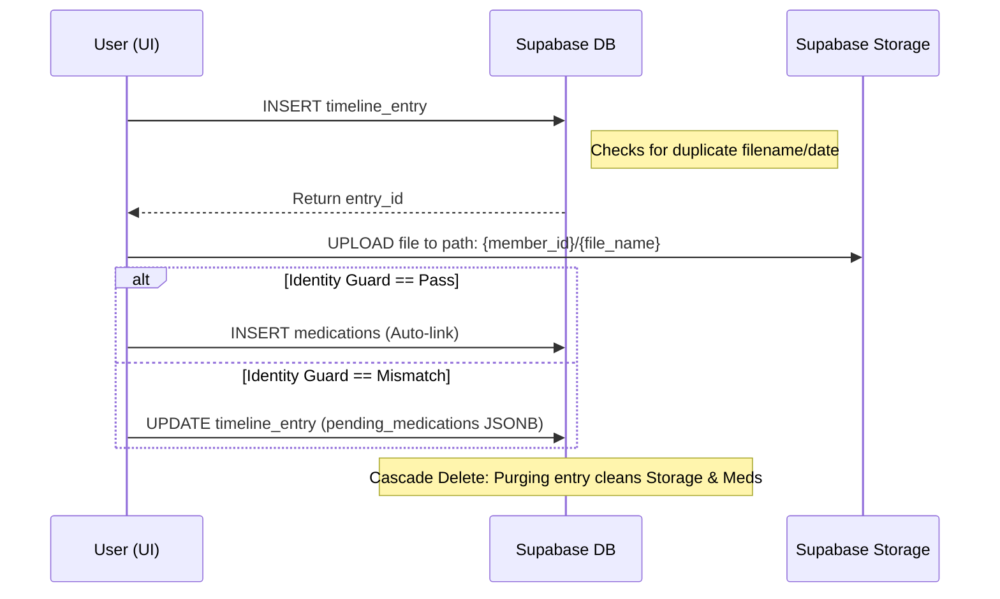
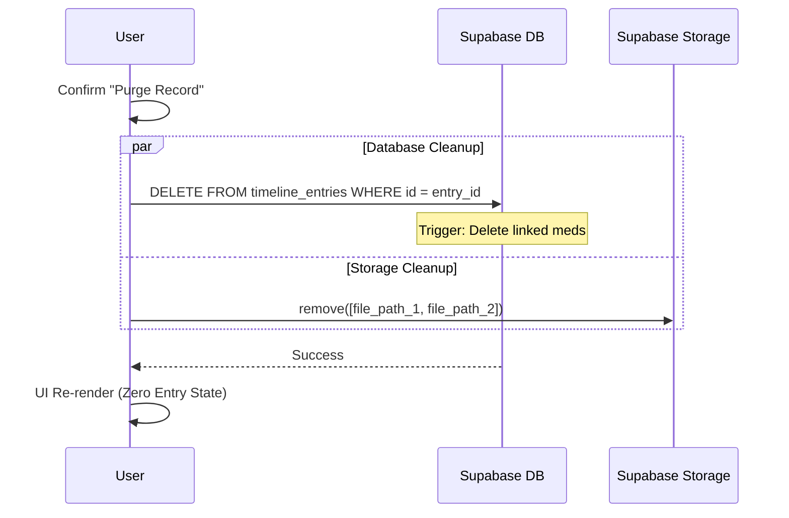

# medHist v1.3.1: Technical Sequence & Architecture

This document tracks the data lifecycle from user interaction to persistent clinical records, specifically detailing the "Zero-Latency" state management and the AI-driven extraction pipeline.

---

## 🔐 1. The Authentication & Hydration Flow
When a user logs in, the system performs a multi-stage hydration to build the "Family Context." This ensures that subsequent navigation (like clicking a member card) is instantaneous.

---

## ⚡ 2. Member Interaction Journeys

### A. Clicking a Member Card (Timeline Navigation)
*   **User Journey**: Dashboard -> Click Card (e.g., "Nilesh") -> View Timeline.
*   **API Calls**: **Zero**. Data is already in memory from hydration.
*   **Response**: Instantaneous UI transition (~16ms).

### B. Clicking "Meds" (Pharmacy Registry Management)
*   **User Journey**: Dashboard -> Click "Meds" -> `MedicationManager` Modal opens.
*   **API Calls**: **Zero** for opening (uses cached state).
*   **Response**: High-density list of active and archived medications.

### C. "Brief" Generation (Clinical Export)
*   **User Journey**: Dashboard/Timeline -> Click "Brief".
*   **API Calls**: **Zero** (Data is cached). **External CDN** (Loads jsPDF/AutoTable if not present).
*   **Execution**: Purely Client-Side. System assembles PDF from local state.
*   **Response**: Browser triggers `.pdf` download.

---

## 💊 3. Manual Registry Updates

### A. Adding/Stopping Medications
*   **User Journey**: Med Manager -> "Add" or "Stop Circle".
*   **DB Operation**: `INSERT` or `PATCH` on `medications` table.
*   **Logic**: Stopped meds are timestamped with `stopped_at` for historical accuracy.
*   **Response**: Optimistic UI update + `onRefreshData` callback.

### B. Sharing a Record
*   **User Journey**: Timeline -> Click "Share" (Triple dot/Share icon).
*   **API Calls**: **Supabase Storage RPC** (createSignedUrl).
*   **DB**: None (uses file_path from existing state).
*   **Response**: 24-hour signed link copied to clipboard.

---

## 🤖 4. Core AI Interaction (The Extraction Pipeline)
The clinical intelligence engine combines client-side PDF processing with the Gemini LLM.

---

## 💾 5. Data Persistence & Cascading Logic
The system enforces high integrity for medical records.

---

## ⚠️ 6. Error & Fallback Paths

### Record Deletion (The Purge Flow)
*   **User Journey**: Timeline -> Trash Icon -> Confirm.
*   **API Calls**: **DELETE** to `timeline_entries`. **REMOVE** to Supabase Storage.
*   **Logic**: Critical cascading delete. We must remove physical files from storage to maintain privacy.
*   **Response**: Immediate removal from timeline UI.

---
*medHist Architectural Specs v1.3.1*
